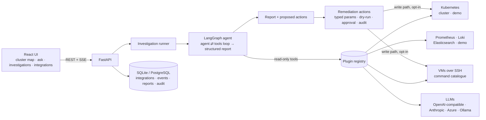

# SRE Copilot

An AI site-reliability engineer for your platform. Describe a problem in plain words — *"customers can't pay"* —
and the copilot investigates across Kubernetes, VMs, metrics and logs, explains the root cause in language a
non-engineer understands, and proposes a fix that runs **only after a server-side dry-run and a human approval**.
Nobody needs to know `kubectl`, PromQL or shell commands.

- **Interactive cluster map** — every namespace with live health, and a graph of how ingresses, services,
  workloads, pods, volumes and config connect. Click any resource to read its events, YAML or logs, and
  investigate or ask about it in one click.
- **Ask anything** — "Which workloads are close to their memory limits?", "Is disk space OK on my VMs?"
  Threads support follow-up questions.
- **Incident investigations** — a LangGraph agent gathers evidence in parallel, correlates timestamps with
  rollouts, checks metrics trends and centralised logs, then writes a structured report: summary, impact,
  root cause with confidence, cited evidence, timeline and prioritised recommendations.
- **Safe remediation** — rollback, rolling restart, scale, recycle pod, cordon/uncordon, admin-defined VM
  runbooks. Proposed by the AI, validated against typed schemas, dry-run on the server, approved by an operator,
  audit-logged.
- **Everything is configurable, nothing is hard-coded** — LLMs, clusters, VM fleets and monitoring backends are
  plugins whose config forms are generated from their schemas. Add them in the UI or GitOps-style from YAML.
- **Air-gap ready** — self-hosted LLMs (vLLM, Ollama, any OpenAI-compatible server), no external fonts or
  CDNs in the UI, images can be mirrored to Harbor.
- **Institutional memory** — past incidents and the fixes that worked are searched and fed into new investigations.

## Time-based investigation (how incidents are investigated)

Every incident investigation is built around **one timeline across every technology layer**:

| Layer | What is collected |
|---|---|
| Change | Rollouts with the exact pod-template diff between revisions (image, env, resources, probes) |
| Infra | Node conditions and node events; with VM integrations, journal warnings and disk usage |
| Kubernetes | Events, container exits / OOM kills (first failure estimated from restarts + back-off), scheduling failures |
| Dependency | Datastore Services (postgres, redis, kafka…) losing their endpoints |
| Application | Error lines and **stack traces** (Python, Java, Go, Node.js) from pod logs, Loki or Elasticsearch |
| Network | Services losing ready endpoints, mesh errors |
| Impact | Error-rate onset from Prometheus, firing alerts |

1. **Scope**: the resource you asked about (from the cluster map, a `ns/name` in the prompt, or the most severe failure).
2. **Collect**: every integration returns timestamped events and dependency relations, in parallel, with no LLM.
3. **Correlate**: duplicates are merged (the same failure on several pods becomes one event ×N), resources connected
   to the problem are found through the dependency graph, and the **origin** and **causal chain** are proposed from
   timing and dependencies. Events on unconnected resources are listed as *unrelated*.
4. **Review**: the model gets the ready-made timeline, verifies or corrects the chain, and uses tools only to fill gaps.
5. **Report**: swimlane timeline, event log, evidence per event, causal chain, root cause and ordered fixes.

The demo cluster includes two incidents to try it on: a bad release in `payments`, and a full node disk in `sre-demo`
that evicts the database and breaks the backend two layers above it.

## Quick start (2 minutes, no infrastructure)

The demo cluster simulates an RKE2 cluster with a real-looking incident: a bad `payments-api` release
(revision 7 set `DB_POOL_SIZE=twenty`) crash-loops, the payments Service has no endpoints and shop checkout
returns 503s. A second, unrelated problem — `ledger-worker` being OOMKilled — and a node with disk pressure are
there too, to see whether the copilot separates cause from noise.

```bash
# backend
cd backend
pip install -e ".[dev]"
SRECOPILOT_SEED_DEMO=true uvicorn app.main:app --reload --port 8000

# frontend (second terminal)
cd frontend
npm install && npm run dev        # http://localhost:5173
```

Then open **Integrations → AI models → Add** and configure an LLM (OpenAI-compatible, Anthropic, Azure OpenAI or
Ollama). Go to **Investigations** and type *"Checkout is failing for customers"*. Approve the proposed rollback
and watch the cluster map turn green.

Or run everything in containers:

```bash
export SRECOPILOT_SECRET_KEY=$(python -c "from cryptography.fernet import Fernet; print(Fernet.generate_key().decode())")
docker compose up --build           # http://localhost:8000
```

## Architecture



**Read path vs write path.** Tools the agent can call are read-only by construction. The only code that changes
infrastructure lives in `backend/app/remediation/`, is reachable only through the approval API, and requires both
`allow_remediation: true` on the integration and the operator role.

### How an investigation runs

1. The scope (cluster(s), monitoring, VMs, optional namespace/resource focus) selects plugin instances; each
   contributes its tools, namespaced by integration name (`prod_rke2__get_pod_logs`).
2. The agent loop calls tools in parallel (bounded concurrency, per-tool timeout). Every tool output is
   redacted (keys, tokens, passwords, JWTs, connection-string credentials) and truncated before reaching the LLM,
   and every call and result is persisted as an event and streamed to the UI.
3. When the agent stops (or hits the step budget), the transcript is flattened and the model writes a JSON
   report validated against a pydantic schema (one automatic repair attempt if invalid).
4. Recommendations that reference a catalogued action are validated (action exists, target integration is in scope
   and of the right kind, parameters match the schema) and stored as remediation proposals. Anything else stays a
   manual recommendation, annotated with why it could not be automated.

## Configuration

All server settings are environment variables prefixed `SRECOPILOT_` — see `backend/app/core/config.py` and
`.env.example`. The important ones:

| Variable | Default | Purpose |
|---|---|---|
| `SECRET_KEY` | generated in dev | Fernet key encrypting integration secrets at rest. **Required in production.** |
| `DATABASE_URL` | SQLite in `./data` | Use `postgresql+asyncpg://…` for production. |
| `AUTH_MODE` | `none` | `token` (static bearer tokens) or `header` (behind oauth2-proxy / SSO). |
| `AUTH_TOKENS` | | `token:role:name,…` — roles `viewer`, `operator`, `admin`. |
| `REMEDIATION_MODE` | `approval` | `disabled` turns the copilot into a pure read-only advisor. |
| `BOOTSTRAP_FILE` | | YAML of integrations to upsert at startup (see `deploy/integrations.example.yaml`). |
| `PLUGIN_MODULES` | `[]` | Extra Python modules to import, for your own plugins/actions. |
| `AGENT_MAX_STEPS` / `AGENT_TIMEOUT_SECONDS` | 30 / 900 | Investigation budget. |
| `TIMELINE_ENABLED` / `TIMELINE_LOOKBACK_MINUTES` | `true` / 60 | Time-based collection and correlation before the model reasons. |
| `STREAM_RESPONSES` | `true` | Stream model output token-by-token into the investigation timeline. |

**Roles:** viewers browse and investigate; operators also dry-run/approve/reject remediations and see the audit
log; admins manage integrations.

### Integrations

| Kind | Types | Notes |
|---|---|---|
| LLM | `openai_compatible`, `anthropic`, `azure_openai`, `ollama` | Needs tool calling. For self-hosted, a 30B+ instruct model with a 32k context is a sensible floor. |
| Kubernetes | `cluster`, `demo` | `auth_mode`: `in_cluster`, `kubeconfig` (pasted) or `token`. Namespace allow/deny lists. `extra_kinds` makes CRDs (Istio, Argo, cert-manager…) readable. Secrets are never read. |
| VM | `ssh` | Host list with labels, key or password auth, known_hosts verification, optional bastion. The LLM chooses from a **catalogue** of diagnostics with regex-validated, shell-quoted parameters — it never writes shell. Add your own diagnostics and write-mode runbooks in config. |
| Monitoring | `prometheus`, `loki`, `elasticsearch`, `demo` | Prometheus covers Thanos/Mimir/VictoriaMetrics; optional Alertmanager. PromQL **query templates** are config — override them to match your exporters. Loki/ES label and field names are configurable. Log results are grouped into patterns so the model sees signal, not 500 identical lines. |

## Deploying on Kubernetes

```bash
docker build -t harbor.internal/platform/sre-copilot:0.1.0 . && docker push harbor.internal/platform/sre-copilot:0.1.0
helm install sre-copilot deploy/helm/sre-copilot -n sre-copilot --create-namespace \
  --set secrets.SRECOPILOT_SECRET_KEY=$KEY \
  --set secrets.SRECOPILOT_AUTH_TOKENS="$ADMIN_TOKEN:admin:platform-team"
```

The chart creates a read-only ClusterRole (no Secrets, optional ConfigMaps) and seeds the cluster it runs in as an
`in_cluster` integration. To allow remediation, set `rbac.remediation.enabled=true` **and** `allow_remediation: true`
on the integration. Other clusters are added with a scoped ServiceAccount token. The pod runs as non-root with a
read-only root filesystem. If you use ingress-nginx, keep the `proxy-buffering: off` annotation so investigation
progress streams live.

Production checklist: set `SECRET_KEY` from a Secret, use PostgreSQL, enable `token` or `header` auth, keep
`allow_remediation` off until you trust the setup, mirror the image to your registry, point the LLM at an endpoint
inside your network.

## Extending

A new backend is one class. This adds VictoriaLogs with zero changes elsewhere — the UI form, API
validation, secret encryption and agent tools all come from the class:

```python
from pydantic import BaseModel, Field, SecretStr
from app.plugins import HealthStatus, Plugin, PluginKind, ToolSpec, register_plugin

class VictoriaLogsConfig(BaseModel):
    url: str
    token: SecretStr | None = None          # SecretStr => encrypted at rest, masked in the UI

class SearchArgs(BaseModel):
    query: str = Field(description="LogsQL query")
    minutes: int = 60

@register_plugin
class VictoriaLogs(Plugin):
    kind = PluginKind.MONITORING
    type = "victorialogs"
    display_name = "VictoriaLogs"
    capabilities = frozenset({"logs"})
    Config = VictoriaLogsConfig

    async def health(self) -> HealthStatus: ...
    def tools(self):
        async def search(query: str, minutes: int = 60): ...
        return [ToolSpec("search_logs", "Search logs with LogsQL", SearchArgs, search, "Searched logs for '{query}'")]
```

Ship it in your own package and either list the module in `SRECOPILOT_PLUGIN_MODULES` or expose it under the
`sre_copilot.plugins` entry-point group. New remediation actions follow the same pattern with `@register_action`
(see `backend/app/remediation/kubernetes_actions.py`). A different Kubernetes flavour only implements five raw
primitives (`_list_raw`, `_get_raw`, `_pod_logs`, `_patch`, `_delete`); health analysis, topology, tools and
guardrails are inherited. `backend/tests/scripted_llm.py` is a complete minimal LLM plugin.

## API

OpenAPI docs at `/api/docs`. Main endpoints:

- `GET /api/clusters/{id}/overview` · `/topology?namespace=` · `/resources/{kind}/{name}` · `/logs` · `/events`
- `POST /api/investigations` `{kind: incident|question, prompt, scope}` → `GET /api/investigations/{id}/stream` (SSE, resumable with `?after=seq`) → `POST /api/investigations/{id}/messages` for follow-ups
- `POST /api/remediations/{id}/dry-run` · `/approve` · `/reject`
- `GET/POST/PUT/DELETE /api/integrations`, `POST /api/integrations/test`, `GET /api/plugins`, `GET /api/audit`

## Project layout

```
backend/app
  core/          settings, auth (token / header SSO), secret encryption, redaction
  db/            SQLAlchemy models: integrations, investigations, events, remediations, audit
  plugins/       plugin contract + registry (built-ins, entry points, extra modules)
  connectors/    llm/ kubernetes/ vm/ monitoring/  - one file per backend, plus demo simulators
  agent/         LangGraph loop, tool binding/execution, prompts, report schema
  remediation/   approval-gated actions (Kubernetes, VM runbooks)
  services/      integration pool, investigation runner, event stream, remediation workflow
  api/routes/    REST + SSE
backend/tests    unit tests + end-to-end test (scripted LLM → demo cluster → approved rollback)
frontend/src     React + React Flow UI; integration forms rendered from plugin JSON schemas
deploy/          Helm chart (read-only RBAC by default), bootstrap example
```

Run tests with `cd backend && pytest`.

## Known limits and next steps

- Live event fan-out is in-process: run one replica, or replace `InMemoryBus` in `services/events.py` with
  Redis/NATS (same three methods) to scale horizontally. History is always in the database.
- The schema is created on startup; add Alembic migrations before evolving models on long-lived installs.
- Past-incident similarity is lexical; swap `similar_incidents()` for pgvector embeddings at larger scale.
- Native OIDC is not built in — use `AUTH_MODE=header` behind oauth2-proxy / Keycloak gatekeeper.
- Investigation quality depends on the model; small local models may miss tool-calling conventions.
